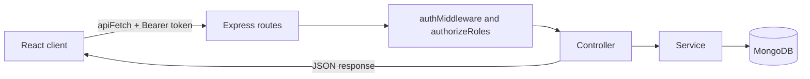
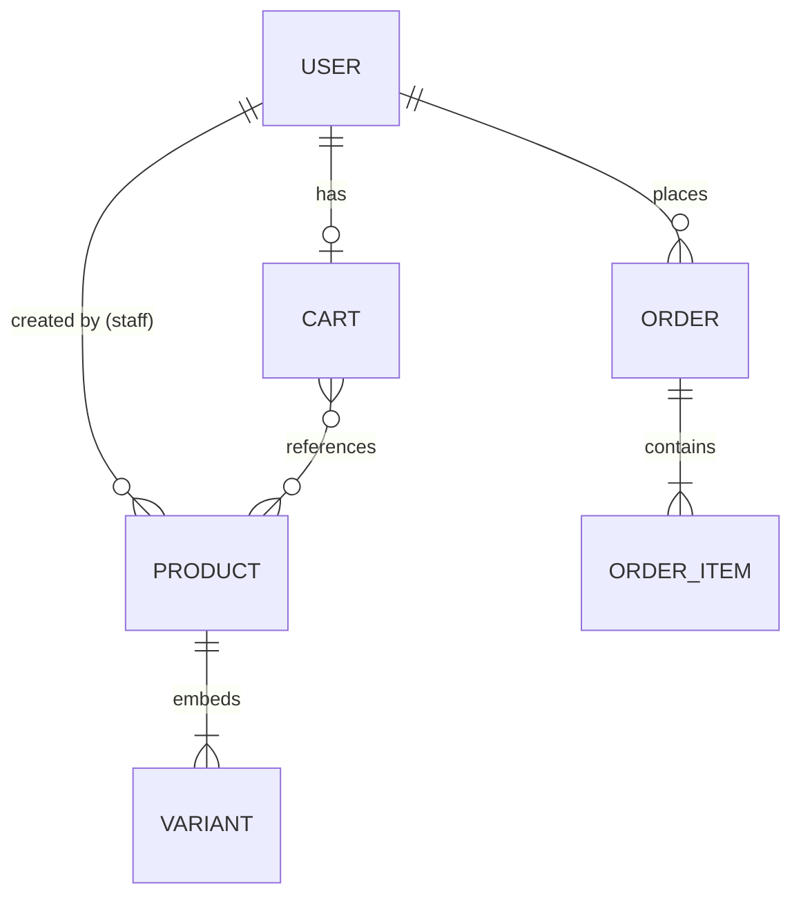

# MiniShop

A full-stack e-commerce web application for a single store, built with the MERN stack. Customers browse products, fill a cart and place Cash on Delivery orders. Staff manage the catalog and move orders through a fulfilment workflow from a role-protected dashboard.


**Live demo:** https://mini-shop-orcin-seven.vercel.app/
<!-- **API:** https://your-api.example.com -->

| Role | Email | Password |
|---|---|---|
| Admin | admin@gmail.com | 123456 |
| Employee | employee@gmail.com | 12345678 |
| Customer | customer@gmail.com | 123456 |

  The free backend host may take about a minute to wake up on the first request.


<!--
  BEFORE PUBLISHING, add screenshots, for example:

  
  
  
-->

## Overview

MiniShop covers the complete path of a small online shop: authentication with roles, a searchable product catalog with variants (color and size), a server-side cart, a transactional checkout, and an order-processing dashboard for staff.

The focus of the project is on getting the back-end rules right: prices are always read from the database, stock cannot be oversold, and every permission is enforced on the server instead of only hidden in the interface.

## Features

### Customers

- Register and log in with a JWT-based session
- Browse products with search, category filter, price range, sorting and pagination
- Product page with variant selection (color and size), live stock and quantity picker
- Cart panel with quantity changes, item removal and a running subtotal
- Checkout form (name, phone, delivery address) with Cash on Delivery
- Order confirmation screen with an order number and the order summary
- Responsive layout, including the cart on mobile

### Staff (employees and admins)

- Role-based redirect after login to the staff dashboard
- **Orders:** see all orders with customer and delivery details, and move each order through its status workflow
- **Products:** create, edit and delete products and their variants through modal forms
- **Profile settings:** update personal details and change the password (current password required)
- Admin-only routes (Overview and Users) protected by a route guard

### Engineering highlights

- **Transactional checkout.** The cart is read, stock is deducted, the order is created and the cart is cleared inside one MongoDB transaction, so a failure rolls everything back.
- **No overselling.** Stock is decremented with a conditional atomic update ("only if enough remains"), so two customers cannot buy the last unit.
- **Server-side pricing.** The client never sends prices or totals. Unit prices come from the product record at checkout time.
- **Order snapshots.** Orders copy the product name, variant, price and delivery details at purchase time, so later edits to a product or a profile never change history.
- **Authorization checked against the database.** The role is re-read from the user record on guarded requests instead of being trusted from the token.
- **Allow-listed input.** Registration always creates a customer and ignores any submitted role. Product, profile and order updates copy only permitted fields.
- **Validated IDs and input types** through a shared helper, and a central error handler that returns one consistent JSON shape.
- **Layered guards on the client.** A single auth helper, a dashboard layout that checks "logged in" and "staff", and a role wrapper for admin-only pages.

## Tech stack

| Layer    | Technologies                                                              |
| -------- | ------------------------------------------------------------------------- |
| Frontend | React 19, React Router 7, Vite 8, Tailwind CSS 4, React Icons, jwt-decode |
| Backend  | Node.js, Express 5, Mongoose 9, JSON Web Tokens, bcrypt, dotenv, cors     |
| Database | MongoDB (transactions require a replica set; MongoDB Atlas provides one)  |
| Tooling  | ESLint, Prettier (with the Tailwind plugin), nodemon                      |

## Architecture



The server follows a **routes, controllers, services, models** layering:

| Layer       | Responsibility                                            |
| ----------- | --------------------------------------------------------- |
| Routes      | Match the path and method, and list the guards in order   |
| Middlewares | Verify the token, check the role, format errors           |
| Controllers | Read the request, call a service, shape the HTTP response |
| Services    | Business rules, validation and database work              |
| Models      | Mongoose schemas and constraints                          |

### How checkout works

1. The customer sends the delivery name, phone and address to `POST /orders/checkout`.
2. The server starts a transaction and loads the customer's cart.
3. For each cart item it loads the product and variant, then deducts stock only if enough remains.
4. It builds the order items from database values (name, variant, unit price), saves the order and deletes the cart.
5. If any step fails, the transaction aborts and nothing is changed.

## Project structure

```text
MiniShop/
├── client/                      React application (Vite)
│   └── src/
│       ├── component/
│       │   ├── AuthComponents/        Login, sign up
│       │   ├── ButtonComponents/      Cart panel, sort button
│       │   ├── CardComponents/        Product and metric cards
│       │   ├── LayoutComponents/      Main layout, navbar, footer, dashboard layout and sidebar
│       │   └── ProductDashComponents/ Create and edit product modals
│       ├── pages/                     Home, products, product details, auth
│       │   └── DashboardPages/        Orders, products, profile settings, overview, users
│       ├── utils/                     API helper, auth helper, role guard
│       └── App.jsx                    Route tree
└── server/                      Express API
    ├── controllers/             HTTP layer
    ├── services/                Business logic
    ├── models/                  User, Product, Cart, Order
    ├── routes/                  Route definitions and guards
    ├── middlewares/             Auth, role check, error handler
    ├── utils/                   Shared helpers
    └── index.js                 App entry point
```

## Data model



| Entity  | Main fields                                                                                                        | Notes                                                     |
| ------- | ------------------------------------------------------------------------------------------------------------------ | --------------------------------------------------------- |
| User    | name, email, password (hashed), role, phone, address, country, date of birth                                       | Roles: `customer`, `employee`, `admin`                    |
| Product | name, price, description, category, brand, variants, owner                                                         | Variants (color, size, stock) are embedded in the product |
| Cart    | user, items (product, variant, quantity)                                                                           | Stores references only, so it always shows current prices |
| Order   | user, items, customer name, phone, delivery address, subtotal, fee, total, payment method and status, order status | Items and delivery details are copies frozen at purchase  |

**Reference or copy.** A cart is a live intention, so it references products. An order is a historical record, so it copies the data it needs.

## Roles and permissions

| Capability                              | Visitor | Customer  | Employee | Admin             |
| --------------------------------------- | ------- | --------- | -------- | ----------------- |
| Browse and search products              | Yes     | Yes       | Yes      | Yes               |
| Register and log in                     | Yes     | n/a       | n/a      | n/a               |
| Cart and checkout                       | No      | Yes       | No       | No                |
| View own orders (API)                   | No      | Yes       | No       | No                |
| View all orders and update their status | No      | No        | Yes      | Yes               |
| Create, edit and delete products        | No      | No        | Yes      | Yes               |
| Update own profile and password         | No      | Yes (API) | Yes      | Yes               |
| Dashboard Overview and Users pages      | No      | No        | No       | Yes (in progress) |

Employees and admins currently share the same API permissions. The admin-only dashboard pages are protected by a route guard, and admin-only API endpoints are planned.

## Order lifecycle

Orders move forward one step at a time. The server rejects any other transition.

```text
pending → confirmed → processing → shipped → delivered
```

Payment is Cash on Delivery, and the payment status is tracked separately from the order status. Order cancellation with stock restoration is planned.

## API reference

All responses are JSON. Failures use `{ "success": false, "message": "..." }`, and cart and order errors also include a `code`. Protected routes expect the header `Authorization: Bearer <token>`.

### Authentication and profile

| Method | Endpoint             | Access    | Description                                     |
| ------ | -------------------- | --------- | ----------------------------------------------- |
| POST   | `/register`          | Public    | Create a customer account                       |
| POST   | `/login`             | Public    | Returns a JWT (valid for one day)               |
| GET    | `/users/me`          | Logged in | Get the current profile                         |
| PUT    | `/users/me`          | Logged in | Update the current profile                      |
| PATCH  | `/users/me/password` | Logged in | Change password (requires the current password) |

### Products

| Method | Endpoint        | Access          | Description                                                                     |
| ------ | --------------- | --------------- | ------------------------------------------------------------------------------- |
| GET    | `/products`     | Public          | List with `search`, `category`, `minPrice`, `maxPrice`, `sort`, `page`, `limit` |
| GET    | `/products/:id` | Public          | Product details with variants                                                   |
| POST   | `/products`     | Employee, admin | Create a product                                                                |
| PUT    | `/products/:id` | Employee, admin | Update a product                                                                |
| DELETE | `/products/:id` | Employee, admin | Delete a product                                                                |

### Cart (customers)

| Method | Endpoint              | Description                                        |
| ------ | --------------------- | -------------------------------------------------- |
| GET    | `/cart`               | Get the cart with product details                  |
| POST   | `/cart/items`         | Add an item (`productId`, `variantId`, `quantity`) |
| PATCH  | `/cart/items/:itemId` | Change the quantity                                |
| DELETE | `/cart/items/:itemId` | Remove an item                                     |

### Orders

| Method | Endpoint                  | Access          | Description                                                 |
| ------ | ------------------------- | --------------- | ----------------------------------------------------------- |
| POST   | `/orders/checkout`        | Customer        | Place an order (`customerName`, `phone`, `deliveryAddress`) |
| GET    | `/orders/my`              | Customer        | List own orders                                             |
| GET    | `/orders/my/:orderId`     | Customer        | Get one of own orders                                       |
| GET    | `/orders`                 | Employee, admin | List all orders                                             |
| PATCH  | `/orders/:orderId/status` | Employee, admin | Move an order to its next status                            |

## Getting started

### Prerequisites

- A current LTS release of Node.js (Express 5 and Vite 8 need a recent version) and npm
- A MongoDB database that runs as a replica set. A free [MongoDB Atlas](https://www.mongodb.com/atlas) cluster works, because checkout uses transactions. A plain standalone local MongoDB will not.

### 1. Clone

```bash
git clone https://github.com/devMasrafi/MiniShop.git
cd MiniShop
```

### 2. Start the API

```bash
cd server
npm install
```

Create `server/.env`:

```env
PORT=5000
MONGODB_URI=your-mongodb-connection-string
JWT_SECRET=a-long-random-string
```

Then run:

```bash
npm run dev
```

### 3. Start the client

```bash
cd ../client
npm install
```

Create `client/.env`:

```env
VITE_API_URL=http://localhost:5000
```

Then run:

```bash
npm run dev
```

Open the address that Vite prints (usually `http://localhost:5173`).

### 4. Create your first staff account

Registration always creates a customer. To get a staff account, register through the app, then change that user's `role` field to `admin` or `employee` in your database, and log in again so the new role is stored in your token.

### Scripts

| Location | Command           | Purpose                      |
| -------- | ----------------- | ---------------------------- |
| server   | `npm run dev`     | Start the API with nodemon   |
| server   | `npm start`       | Start the API with Node      |
| client   | `npm run dev`     | Start the Vite dev server    |
| client   | `npm run build`   | Create a production build    |
| client   | `npm run preview` | Preview the production build |
| client   | `npm run lint`    | Run ESLint                   |

### Environment variables

| App    | Variable       | Purpose                    |
| ------ | -------------- | -------------------------- |
| Server | `PORT`         | Port the API listens on    |
| Server | `MONGODB_URI`  | MongoDB connection string  |
| Server | `JWT_SECRET`   | Secret used to sign tokens |
| Client | `VITE_API_URL` | Base URL of the API        |

Never commit `.env` files. Variables starting with `VITE_` are included in the browser bundle, so they must never hold secrets.

## Project status and roadmap

**Working today:** authentication and roles, product catalog with filters, product details with variants, cart, transactional checkout with order confirmation, staff order processing, staff product management, profile and password update.

**In progress**

- [ ] Customer area with order history, order detail and a status timeline
- [ ] Customer profile page (the existing profile page lives in the staff dashboard)
- [ ] Dashboard Overview with real figures (currently placeholder numbers)
- [ ] Users page for admins to manage roles
- [ ] Seed script for sample data and demo accounts

**Planned**

- [ ] Product images and a published/archived status
- [ ] Order cancellation with stock restoration, and marking Cash on Delivery orders as paid
- [ ] Forgot password and password reset by email
- [ ] Automated tests for checkout totals, stock handling and role permissions
- [ ] Security hardening: restricted CORS, rate limiting, security headers, escaped search input, bounded pagination
- [ ] Admin-only API endpoints for statistics and user management
- [ ] Deployment with a live demo

## Author

**Masrafi**

- GitHub: [@devMasrafi](https://github.com/devMasrafi)
- LinkedIn: [devmasrafi](https://www.linkedin.com/in/devmasrafi/)
